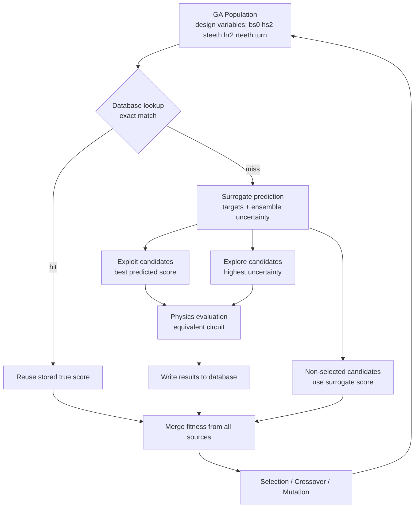

# ML-Assisted Genetic Algorithm for Motor Design Optimization

Surrogate-assisted optimization | Genetic Algorithm | Engineering Design

This project explores how **machine learning can accelerate genetic algorithm (GA) optimization** in engineering design problems where each evaluation is expensive.

Using **induction motor design optimization** as a case study, a surrogate model is integrated into the GA evaluation step. Instead of filtering candidates, the surrogate is used to **allocate a limited physics-evaluation budget**: each generation, only the most promising and the most uncertain candidates are evaluated with the physics model.

In the reported run, the resulting **ML-assisted Genetic Algorithm (MLGA)** reduced physics evaluations by 70% and runtime by about 2.35×, while reaching a best fitness at least as good as the Pure GA baseline.

---

# MLGA System Architecture



Each individual's fitness comes from one of three sources:

| Path | Fitness source |
|------|----------------|
| DB hit | stored physics result (`true_score`) |
| Selected (exploit / explore) | new physics result (`true_score`), written back to the DB |
| Non-selected | surrogate prediction (`surrogate_score`) |

---

# Key Results

EP.4 main experiment: population 500, 400 generations. These historical results are separate from the run whose outputs are currently saved in the notebook.

| Method | Runtime (sec) | Physics Evaluations | Best Fitness |
|--------|--------------:|--------------------:|-------------:|
| Pure GA | 1780 | 200,000 | -3.233 |
| MLGA | 758 | 60,000 | -3.317 |

Lower fitness is better.

- **~2.35× speedup** (1780 / 758).
- **70% fewer physics evaluations** ((200,000 − 60,000) / 200,000).
- **Best fitness:** -3.317 for MLGA vs. -3.233 for Pure GA.

**Limitations:** these results come from a single run with a fixed random seed. The reduction in physics evaluations follows directly from the configured budget. The best-fitness difference has not yet been tested across multiple seeds, so it should not be read as a statistically established improvement.

---

# Background

Induction motor design optimization involves tuning multiple geometric and electrical parameters to achieve better efficiency and torque characteristics while satisfying engineering constraints.

In a traditional workflow:

1. The GA generates candidate designs.
2. Each design is evaluated with a physics-based model.
3. Fitness values guide the evolutionary search.

```
GA Population
↓
Physics Evaluation
↓
Fitness
↓
Selection / Crossover / Mutation
```

The number of evaluations grows with population size and generations. For example, a population of 500 over 400 generations requires 200,000 evaluations.

This project uses an equivalent-circuit model, which is relatively fast. Many engineering problems instead rely on **finite element analysis (FEA)** or other expensive simulations. In those settings, a single evaluation dominates the cost, and reducing evaluations matters much more.

---

# ML-Assisted Genetic Algorithm (MLGA)

An earlier version of the system used the surrogate as a **feasibility gate**, discarding candidates predicted to be infeasible. That reduced some physics calls but did not improve overall efficiency, and the gate became ineffective once the population converged.

MLGA reframes the question:

> In each generation, which candidates are worth spending an expensive physics evaluation on?

The GA operators (selection, crossover, mutation) are unchanged. Only the evaluation step changes:

```
GA Population
↓
Database lookup (reuse known designs)
↓
Surrogate prediction for DB-miss candidates
↓
Exploit + Explore selection
↓
Physics evaluation (selected subset only)
↓
Database update + fitness merge
```

The surrogate consists of a feasibility classifier plus seed-ensemble regressors for each performance target (`eff`, `Tstp`, `Tmscore`, `Ilimite`, `pf`). The predicted targets are combined into a score using the same rule as the physics fitness function. The ensemble's standard deviation serves as the uncertainty estimate.

Because exploit candidates are the ones the surrogate rates most highly, any design whose quality the surrogate overestimates tends to be verified by physics quickly. This limits how long a falsely optimistic prediction can influence the search.

---

# Optimization Strategy

## Pure GA (main experiment)

- Population size: 500
- Generations: 400
- Total physics evaluations: 200,000

## MLGA (main experiment)

- Physics evaluations per generation: 100 exploit + 50 explore = 150
- Total physics evaluations: 150 × 400 = 60,000
- All other individuals use either a DB hit or a surrogate prediction

---

# Experimental Observations

## Convergence Behavior

Both methods improve rapidly in early generations. MLGA entered a high-quality region earlier (around generation 70) and converged to a better best fitness in this run. Pure GA kept making occasional small improvements later in the search but finished at a higher (worse) value.

MLGA's longest stagnation period was longer than Pure GA's (about 163 vs. 111 generations). This matches its earlier convergence: once it reaches a good region, it settles sooner, whereas Pure GA spends longer on late-stage fine-tuning.

## Best Solutions

The two methods converged to different design regions rather than variations of the same design. The largest differences were in `hs2`, `steeth`, and `rteeth`. MLGA's best design has slightly lower efficiency but better `Tstp`, `Tmscore`, and `pf`, which gives it a better overall score.

MLGA's global best was first found through physics evaluation and later re-encountered and served from the database. This confirms that the "discover, then reuse" mechanism works as intended.

## Mean Population Fitness

Mean population fitness is **not directly comparable** between the two methods. In Pure GA, every individual is evaluated by physics. In MLGA, most individuals carry surrogate-predicted fitness, so the population mean partly reflects model predictions.

The best design used for comparison must be evaluated by the original equivalent-circuit calculation model to obtain its **true fitness** (`true_score`); a surrogate prediction alone is not a verified optimization result. Exploit/explore candidates are sent to that model, and their true scores replace their predictions before selection. A later exact DB hit reuses the previously calculated true score.

In the notebook's saved run, the MLGA global-best record has `fitness_source = physics`, `true_score = -3.0940494673005645`, and an earlier surrogate prediction of about -3.201880. Its final-generation record has `fitness_source = db` and the same true score. Both saved best designs were independently re-evaluated with the repaired evaluator and reproduced their recorded true scores. This verifies these reported solutions; the current GA loop itself selects its best from mixed `final_fitness` values and does not enforce physics verification for every possible run. Any future result whose best record still has `fitness_source = ml` needs explicit evaluation before publication.

## Database Reuse

About 10–25 DB hits per generation, roughly 6,000 in total. The exact count varies with the random seed and the database state. DB reuse is not the main source of savings, but it reliably eliminates redundant evaluations.

## Historical Scaling Experiment: Larger Population

To approximate a high-cost setting, the population was increased to 3,000 while the per-generation physics budget was not increased proportionally.

| Method | Runtime (sec) | Best Fitness |
|--------|--------------:|-------------:|
| Pure GA | 9728 | -3.486 |
| MLGA | 1576 | -3.085 |

The speedup grew to about **6.2×**, but MLGA's best fitness was clearly worse in this setting. With a much larger share of individuals ranked by surrogate predictions, prediction errors distort the selection ranking and weaken selection pressure. In other words, MLGA's quality depends on the ratio between the physics budget and the population size, not on the surrogate alone.

These historical scaling figures are not the outputs currently saved in the notebook.

## Current Saved Notebook Run

The notebook is configured for population 3,000, 100 generations, a fixed seed of 42, and 150 exploit + 150 explore physics candidates per generation. Its saved comparison table reports:

| Method | Runtime (sec) | Physics Evaluations (100-generation history) | Best True Fitness |
|--------|--------------:|--------------------------------------------:|------------------:|
| Pure GA | 3445.739044 | 300,000 | -3.128290021160913 |
| MLGA | 716.846705 | 30,000 | -3.0940494673005645 |

- **4.8068× speedup** and **90% fewer physics evaluations** in the recorded generation history.
- MLGA's best true fitness is worse by 0.034241 (about 1.09% relative to the magnitude of the Pure GA score). This is a difference in the composite score, not a 1.09% change in motor efficiency.
- The saved MLGA history records 2,827 DB hits.

This run supports a computation-efficiency advantage with a modest loss in best-solution quality, rather than better performance on both measures. It is a single saved run, not a new full experiment executed as part of the documentation update.

**Counting convention:** the notebook sums physics calls from the 100-generation history. The current `run_ga_fast` implementation also evaluates the final population after that loop; its extra calls are excluded from those history totals. Runtime covers the full run. The notebook imports `run_ga`, whereas the published core currently exposes `run_ga_fast`, so the saved outputs should be treated as historical evidence rather than proof that the present checkout runs end to end unchanged.

---

# Repository Structure

| Path | Contents |
|------|----------|
| `core/ga_core.py` | GA loop: initialization, selection, crossover, mutation |
| `core/ml_gate.py` | Surrogate prediction, uncertainty estimation, exploit/explore selection |
| `core/evaluator.py` | Physics evaluation (equivalent circuit) |
| `core/db_search.py` | Design database lookup and reuse |
| `notebooks/mlga_experiment.ipynb` | Experiment notebook (Pure GA vs. MLGA) |
| `results/figures/` | Placeholder for result figures |
| `LICENSE` | MIT License |

**Not included:** the training dataset (`mlga_db_v1.csv`) and the trained surrogate models (feasibility classifier, per-target regressor ensembles, and metadata) are not published. The code shows the full pipeline, but it cannot be run end to end from this repository alone.

---

## Article Series

This repository accompanies a technical article series, written in **Chinese** and published on **Notion**, that documents the design decisions, experiments, and analysis behind the project.

- EP1 – Original GA optimization system and engineering background
- EP2 – Dataset construction and surrogate model training
- EP3 – ML Gate experiment: early attempts to use ML as a filter
- EP4 – MLGA architecture and experimental results
- EP5 – Result analysis and future directions *(in progress)*

---

# Potential Future Work

- Multi-seed evaluation to quantify variance in best fitness
- Adaptive physics evaluation budget, e.g. scaling with population size
- Better uncertainty estimation, such as bootstrap or heterogeneous ensembles, or computing uncertainty on the final score rather than on individual targets
- Stronger elitism for physics-verified solutions in large-population settings
- Multi-objective optimization (e.g. NSGA-II)
- Integration with high-fidelity simulations such as FEA

---

# Key Takeaway

In expensive engineering optimization, machine learning can serve as more than a predictor: it can decide **where to spend the evaluation budget**.

In this project's main experiment:

- physics evaluations were reduced by 70%
- runtime improved by about 2.35×
- best fitness was maintained or improved (single run)

The scaling experiment shows the limit of this approach: when the surrogate has to rank too large a share of the population, solution quality degrades. The physics budget therefore needs to scale with the problem size.

---

# License

MIT License
